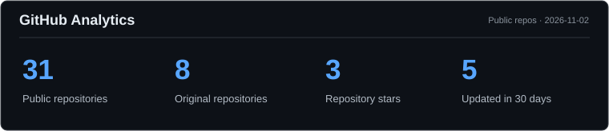
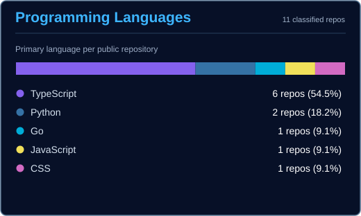

<h1 align="center">Hi, I'm Jeff Queiroz</h1>

  Medical student at <strong>UFMG</strong> · Full-stack development · AI · Web3

  &nbsp;&nbsp;
  &nbsp;&nbsp;
  &nbsp;&nbsp;
  &nbsp;&nbsp;
  

### About me

- Studying **Medicine at the Federal University of Minas Gerais (UFMG), Brazil**.
- Building web applications, healthtech prototypes, and AI-assisted workflows.
- Exploring **Farcaster / Base** integrations and developer tooling.

### Projects

| Repository | What it explores |
| :--- | :--- |
| [**CardioTwin AI**](https://github.com/Euvouserdoutor/CARDIO-TWIN-AI) | Cardiovascular visualization and AI research prototype |
| [**DASH**](https://github.com/Euvouserdoutor/DASH) | Cryptocurrency data dashboards and visualizations |
| [**Donut Factory**](https://github.com/Euvouserdoutor/WARPLET-XRAY) | Farcaster mini app and personalized artwork experiments |
| [**Personal website source**](https://github.com/Euvouserdoutor/jefferson-poke-site-source) | Website source and frontend experiments |
| [**Euvouserdoutor**](https://euvouserdoutor.com) | Medicine and science education website |

### Languages & Tools

**Languages** · `TypeScript` `JavaScript` `Python`

**Frontend** · `React` `Next.js` `HTML` `CSS`

**Backend & Data** · `Node.js` `PostgreSQL` `Supabase`

**Cloud & Tools** · `Git` `GitHub Actions` `Vercel`

**AI & Web3** · `Gemini` `Farcaster` `Base`

### GitHub Analytics

  
  

Real public-repository metadata, generated locally and refreshed by [GitHub Actions](.github/workflows/profile-analytics.yml). Private projects and private contributions are not included. Languages are based on each repository's primary language, not lines of code.

---

  <a href="https://jefferson.poke.site/">Website</a> ·
  <a href="https://euvouserdoutor.com">Medical Education</a> ·
  <a href="https://farcaster.xyz/icekiss.eth">Farcaster</a> ·
  <a href="https://x.com/useleszboy">X</a>

Health-related projects listed here are experimental unless explicitly stated otherwise; they are not clinical decision-making tools.
