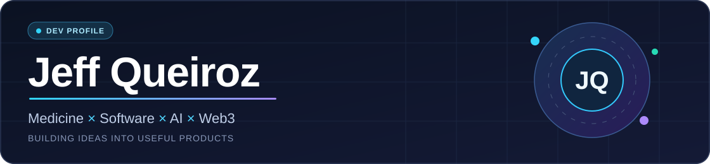

<h3>Medical Student at UFMG · AI &amp; Software Builder</h3>

<strong>Turning ideas into useful products.</strong>

Medicine × Artificial Intelligence × Software × Web3

  <a href="#featured-projects"><strong>Explore Projects</strong></a> &nbsp;·&nbsp;
  <a href="#tech-stack"><strong>Tech Stack</strong></a> &nbsp;·&nbsp;
  <a href="#current-focus"><strong>Current Focus</strong></a> &nbsp;·&nbsp;
  <a href="#connect"><strong>Connect</strong></a>

About Me
I'm Jeff Queiroz, a medical student at the Federal University of Minas Gerais (UFMG), Brazil, and an independent software builder.

I build at the intersection of healthtech, AI engineering, full-stack development, and Web3.

My goal: transform complex problems into practical, well-designed digital experiences.
Featured Projects

  
<em>Selected public projects and experiments.</em>

<table>
  <tr>
    <td width="50%" valign="top">
      
      
<strong>CardioTwin AI</strong>

      
Experimental cardiovascular visualization and AI research.

      
Healthtech · AI · Visualization

    </td>
    <td width="50%" valign="top">
      
      
<strong>Euvouserdoutor</strong>

      
Medical education, science communication, and digital learning.

      
Medicine · Education · Technology

    </td>
  </tr>
  <tr>
    <td width="50%" valign="top">
      
      
<strong>DASH Crypto Pulse</strong>

      
Experiments in cryptocurrency data visualization and dashboards.

      
Web Development · Data · Web3

    </td>
    <td width="50%" valign="top">
      
      
<strong>Farcaster Mini App Experiments</strong>

      
Interactive onchain prototypes and creative mini app development.

      
Farcaster · Base · React

    </td>
  </tr>
</table>

  
<strong>More Projects — Private Development</strong>

  <h3>Clinical Pro</h3>
  
Software exploring clinical workflows, patient management, and scheduling.

  <h3>Anamnese Green</h3>
  
AI-assisted clinical documentation and structured medical histories.

  <h3>Fardrop</h3>
  
Farcaster/Base mini app exploring digital collectibles, tasks, and community participation.

  
Projects are in development. Listed features do not imply production availability or clinical validation.

Tech Stack

  <h3>Languages</h3>
  
<code>TypeScript</code> &nbsp; <code>JavaScript</code> &nbsp; <code>Python</code>

  <h3>Frontend</h3>
  
<code>React</code> &nbsp; <code>Next.js</code> &nbsp; <code>Responsive UI</code>

  <h3>Backend &amp; Data</h3>
  
<code>PostgreSQL</code> &nbsp; <code>Supabase</code> &nbsp; <code>REST APIs</code>

  <h3>Cloud &amp; Development</h3>
  
<code>Vercel</code> &nbsp; <code>GitHub</code> &nbsp; <code>GitHub Actions</code>

  <h3>AI &amp; Web3</h3>
  
<code>Gemini</code> &nbsp; <code>AI Automation</code> &nbsp; <code>Base</code> &nbsp; <code>Farcaster</code>

Current Focus
Area	Building & Exploring
AI Engineering	Practical AI applications and workflow automation
Medical Technology	Clinical software and educational tools
Full-Stack Software	Reliable web applications and product design
Onchain Products	Farcaster mini apps and Base integrations

Engineering Principles
Build with purpose. Focus on real problems and usable solutions.

Design for people. Make complex tools intuitive and accessible.

Validate before shipping. Prioritize testing, reliability, and security.

Keep improving. Learn through iteration, feedback, and experimentation.
Connect

  
<strong>Interested in healthtech, AI, software, or Web3?</strong>

  
  
  

    <a href="https://euvouserdoutor.com">Medical Education</a> &nbsp;·&nbsp;
    <a href="https://www.linkedin.com/in/jeffqueiroz-med">LinkedIn</a> &nbsp;·&nbsp;
    <a href="https://www.instagram.com/euvouserdoutor">Instagram</a> &nbsp;·&nbsp;
    <a href="https://base.app/profile/0x07b6a74fFC4b7aB17157f088A8CD82d8897d70C4">Base Profile</a>
  

  <h3>Medicine × Software × Artificial Intelligence × Web3</h3>
  
<strong>Learn. Build. Test. Improve.</strong>

  
Personal portfolio · Projects, research, and ongoing experiments

  
Healthcare-related experiments are not substitutes for validated clinical systems or professional judgment.

